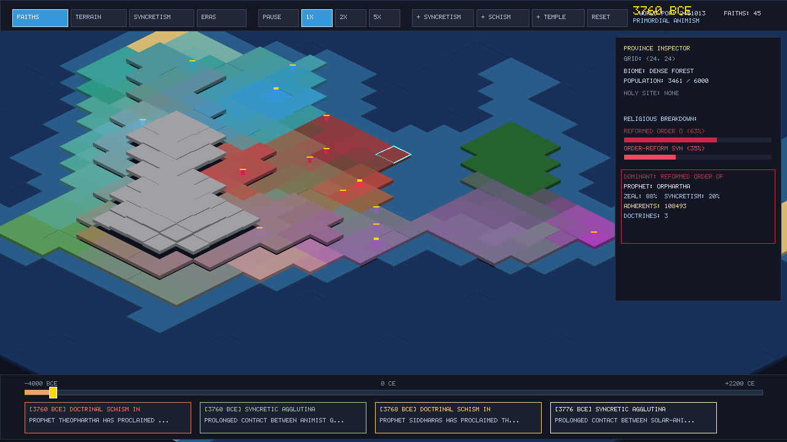

# Chronicles of Faith: 2D Isometric Religion Simulator (C++)

A high-performance **2D Isometric Religion Simulator** developed in modern C++ (C++17) featuring procedural world generation, spatial contagion **replication**, syncretic **agglutination**, doctrinal **schisms**, dynamic **advancement eras**, a scrubbable **time line**, and an interactive **event line chronicle**.



---

## 🌟 Core Simulation Mechanics

### 1. 2D Isometric View & Camera
* **Isometric Projection**: Diamond coordinate transformations $(x, y, h) \to (\text{screen}_x, \text{screen}_y)$ with 3D elevation skirts.
* **Smooth Camera Control**:
  * **Zoom**: Mouse wheel or `+`/`-` keys to zoom between macroscopic planetary overview ($0.2\times$) and detailed province level ($3.5\times$).
  * **Pan**: Right-click drag or `W/A/S/D` / Arrow keys.
  * **Tile Picking**: Exact reverse isometric mathematical raycasting converts mouse clicks to grid coordinates $(gx, gy)$.

### 2. Global Map & Provinces (Cells)
* Procedural continent generation using multi-octave harmonic noise.
* Biomes: Deep Oceans, Shallow Coastal Waters, Fertile River Valleys, Coastal Plains, Dense Forests, Highland Hills, Arid Deserts, Rugged Mountains, and Frozen Tundras.
* Carrying capacities, population demographics (logistic growth curve), and trade connectivity.

### 3. Replication Engine (Diffusion & Spreading)
* **Spatial Contagion**: Faith diffuses to adjacent cells weighted by zeal, shrine level, and terrain friction (rivers/coasts accelerate diffusion; mountains isolate).
* **Demographic Momentum**: Adherents reproduce proportionally with local population expansion.
* **Missionary Caravans**: High-piety holy sites dispatch active missionary caravans traveling along trade routes to foreign provinces.

### 4. Agglutination & Schisms (Evolutionary Dynamics)
* **Syncretic Agglutination (Merging)**:
  * When two religions coexist in a region over multiple generations with mutual tolerance, an agglutination threshold is triggered!
  * Birthed syncretic faith inherits blended names, hybrid doctrines, unified symbols, and blended colors.
* **Doctrinal Schisms & Reformations**:
  * Vast geographic spread across mountain passes or divergent cultural frontiers creates theological friction.
  * Reformer prophets emerge, founding daughter schisms (e.g. *Reformed*, *Orthodox*, *Pure*, *Covenant* denominations).

### 5. Simulation of Advance (Eras & Tech Tree)
1. **Primordial Animism** (-4000 to -2000 BCE): Spirits of nature, shamanism, local stability.
2. **Archaic Polytheism** (-2000 to -600 BCE): Pantheon cults, divine kingship, city-state temples.
3. **Axial Age of Wisdom & Scripture** (-600 to 500 CE): Moral philosophies, written scrolls, universal canons.
4. **Medieval Scholasticism** (500 to 1450 CE): Monastic networks, pilgrimage routes, great cathedrals.
5. **Age of Printing & Reformations** (1450 to 1800 CE): Movable type printing press multiplying diffusion tenfold; rapid schisms.
6. **Secular Reason & Cosmic Transcendence** (1800 to 2200+ CE): Empirical science, pluralistic tolerance, digital consciousness.

### 6. Time Line & Event Line Chronicle
* **Scrubbable Time Line**:
  * Play, Pause, Speed (1x, 2x, 5x, 10x).
  * History snapshot buffer saves global religious distribution across centuries, enabling player scrubbing backward and forward through history.
* **Event Line Chronicle**:
  * Milestone ticker cards documenting every prophet's awakening, syncretic union, reformation, and holy wonder.
  * Clicking any event card centers camera on the event's geographical epicenter!

---

## 🛠️ Building & Running

### Requirements
* Modern C++ compiler (`g++` or `clang++` with C++17 support)
* `make`
* Optional for native GUI: `libX11` and `OpenGL/GLX` (already configured in Linux)

### Commands
```bash
# 1. Compile and run test suite
make test

# 2. Build the main game executable
make all

# 3. Run in native desktop mode (when running inside an X11 desktop environment)
DISPLAY=:0 ./bin/religion_sim

# 4. Run headless simulation and export a high-res snapshot
./bin/religion_sim --headless --ticks 250 --export simulation_snapshot.ppm
```

---

## 🎮 Desktop Controls

| Action | Control |
|---|---|
| **Select Province** | Left Mouse Click |
| **Pan Camera** | Right Mouse Click + Drag or `W`/`A`/`S`/`D` / Arrow keys |
| **Zoom In / Out** | Mouse Wheel or `+` / `-` |
| **Reset Camera** | `R` key or `[RESET]` button |
| **Pause / Resume** | `Spacebar` or `[PAUSE]` button |
| **View Modes** | `1`: Faiths, `2`: Terrain, `3`: Syncretism Heatmap, `4`: Advancement Eras |
| **Scrub Time** | Click and drag on the bottom timeline bar |
| **Focus Event** | Click on any recent milestone card in the bottom ribbon |
| **Interventions** | `[+ SYNCRETISM]`, `[+ SCHISM]`, `[+ TEMPLE]` buttons |
| **Exit** | `ESC` key |

---

## 📂 Codebase Structure

```
religion_simulator_isometric/
├── Makefile                      # Build automation & test runner
├── README.md                     # Documentation
├── include/                      # Header declarations
│   ├── Types.hpp                 # Vectors, colors, biomes, eras, event structs
│   ├── IsometricCamera.hpp       # Isometric math & camera transformations
│   ├── Religion.hpp              # Faith model, doctrines, lineage & registry
│   ├── Cell.hpp                  # Province terrain, population & religious breakdown
│   ├── WorldMap.hpp              # Procedural generation, hearths, holy sites
│   ├── AdvancementSystem.hpp     # Eras, theology points, doctrine tech tree
│   ├── ReplicationEngine.hpp     # Contagion diffusion & missionary caravans
│   ├── AgglutinationEngine.hpp   # Syncretic blending & doctrinal schisms
│   ├── Timeline.hpp              # Time management, scrubbing & historical snapshots
│   ├── EventLine.hpp             # Chronicle event queue & milestone tracker
│   ├── Renderer.hpp              # Software rasterizer & X11/OpenGL presenter
│   └── Game.hpp                  # Master loop & input orchestration
├── src/                          # Implementation files
│   ├── main.cpp                  # CLI entry point
│   ├── ... (all module cpp files)
└── tests/
    └── test_simulation.cpp       # Comprehensive verification test suite
```
